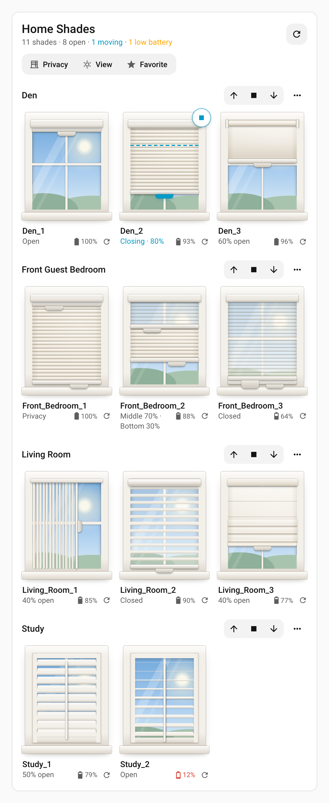
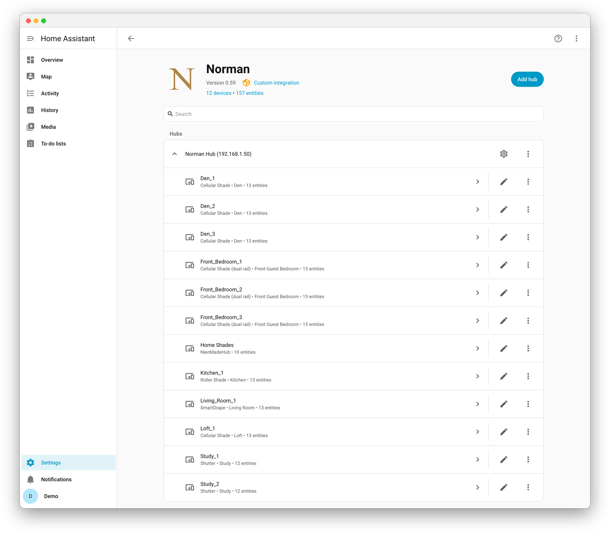
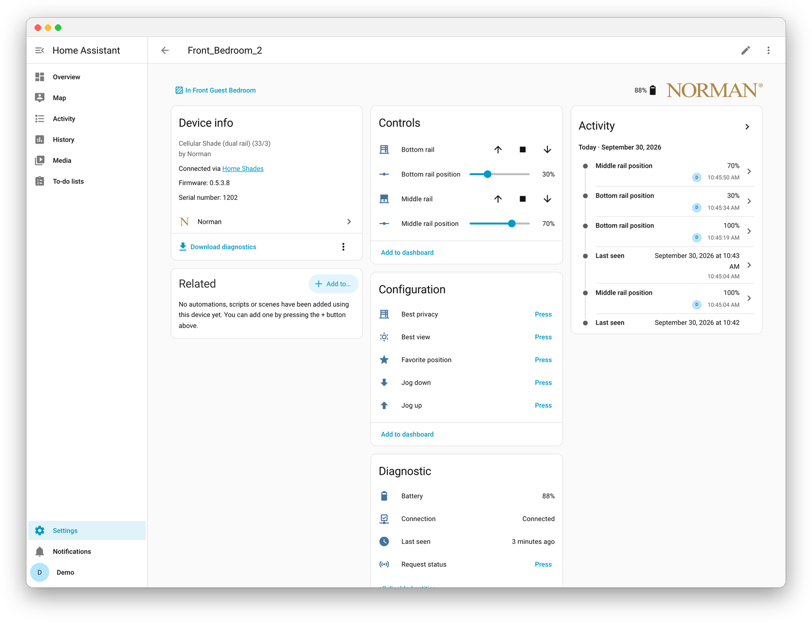

# (Unofficial) Norman smart blinds for Home Assistant

A custom Home Assistant integration for [Norman](https://www.normanusa.com/) motorized
window coverings on a **Norman Gen 2 Hub**, the hub you set up and control with Norman's
**ShadeAuto** app. It has not been tried with other Norman hubs. Norman's earlier **Gen 1**
hub, set up with the older Norman app, speaks a different protocol (on port 80, at a
`NORMANHUB…` address); [Norman-HA-Integration](https://github.com/Herbertmt978/Norman-HA-Integration)
is a separate community integration for it. It talks to the **hub
directly on your local network** — nothing goes through the cloud — and it is **push-based**:
when a blind moves, whether from Home Assistant, a remote, or the ShadeAuto app, Home Assistant
sees the change within a second or two.

> ⚠️ This is an **unofficial** integration, reverse-engineered from the hub's local API. It is
> not affiliated with or endorsed by Norman. The protocol has no vendor documentation and could
> change in a hub firmware update. Use at your own risk; it may void your warranty.

[](https://my.home-assistant.io/redirect/hacs_repository/?owner=kedube&repository=ha-norman&category=integration)
[](https://github.com/kedube/ha-norman/releases)
[](https://github.com/kedube/ha-norman/actions/workflows/ci.yml)
[](LICENSE)



***Norman Shades**, in Home Assistant's sidebar: drag a shade's pull tab, or a shutter's tilt rod,
to move it. It finds your blinds by itself and needs no configuration.*

## Contents

- [Installation](#installation)
- [Upgrading](#upgrading)
- [Configuration](#configuration)
  - [Changing the hub address](#changing-the-hub-address)
  - [Removing the integration](#removing-the-integration)
- [What it provides](#what-it-provides)
  - [Entities](#entities)
  - [Norman Shades](#norman-shades)
  - [Actions](#actions)
  - [Automation ideas](#automation-ideas)
- [How it works](#how-it-works)
- [Languages](#languages)
- [Supported devices](#supported-devices)
- [Known limitations](#known-limitations)
- [Troubleshooting](#troubleshooting)
- [Diagnostics](#diagnostics)
- [Development](#development)
- [Disclaimers](#disclaimers)

**Reference docs** (split out of this README to keep it browsable):

| Document | Contents |
|---|---|
| [docs/dashboard.md](docs/dashboard.md) | **Norman Shades**: what it shows, putting it on a dashboard, and building your own |
| [docs/entities.md](docs/entities.md) | Every entity, device, attribute, and availability rule |
| [docs/options.md](docs/options.md) | Polling, wake sweeps, command spacing, and the sidebar entry |
| [docs/services.md](docs/services.md) | All five actions, and the hub verbs `send_hub_command` can send |
| [docs/NORMAN_API.md](docs/NORMAN_API.md) | The hub's local API, for contributors |

## Installation

> Requirements:
>
> - A Norman Gen 2 Hub, set up in the ShadeAuto app, on the same network as Home Assistant and
>   reachable on TCP port 10123.
> - Home Assistant 2026.3 or newer (`hacs.json` declares this minimum; it is what the
>   bundled brand icon needs). CI tests against the latest Home Assistant release.

### Method 1: HACS (recommended)

Norman is in the HACS default store, so there is no repository to add.

[](https://my.home-assistant.io/redirect/hacs_repository/?owner=kedube&repository=ha-norman&category=integration)

1. In Home Assistant, open **HACS**, or use the button above to go straight to Norman.
2. Search for **Norman**, open it, and click **Download**.
3. Restart Home Assistant.

After restart, add the integration from Home Assistant:

[](https://my.home-assistant.io/redirect/config_flow_start/?domain=norman)

If you added this repository to HACS by hand before it was in the default store, you don't need
to change anything. HACS keeps tracking the same repository and its updates.

### Method 2: HACS custom repository

If Norman doesn't come up in a HACS search, for example because your HACS hasn't refreshed its
list of default repositories yet, add the repository by hand:

1. In Home Assistant, open **HACS**.
2. Open the menu in the top-right corner (**⋮**) and select **Custom repositories**.
3. Paste this repository's URL: `https://github.com/kedube/ha-norman`
4. Set the category to **Integration** and click **Add**.
5. Search for **Norman** in HACS, open it, and click **Download**.
6. Restart Home Assistant, then add the integration as in Method 1.

### Method 3: Manual installation

1. Copy `custom_components/norman` into your Home Assistant `config/custom_components` directory.
2. Restart Home Assistant.
3. Add the integration from **Settings > Devices & services > Add integration**.

## Upgrading

Releases are published by hand, so a change on `main` reaches HACS with the next release.
The [changelog](CHANGELOG.md) lists what each version did, and the
[Releases page](https://github.com/kedube/ha-norman/releases) carries the same notes.

**Through HACS.** HACS checks for new releases on its own schedule and surfaces Norman as an
update when one is available — as an update entity, and in the HACS panel itself.

1. Open **HACS → Norman → Update**, or install it from the update listed at the top of
   **Settings**.
2. **Restart Home Assistant.** A downloaded update does nothing until the restart, because a
   custom integration's files are only read at startup.
3. Confirm the new version under **Settings → Devices & services → Norman**, or on the hub
   device page.

To check for a new release without waiting for HACS, use **HACS → ⋮ → Update information**.

To move to a specific version instead of the newest, use **HACS → Norman → ⋮ → Redownload**
and pick the version. That is also how to roll back.

**Manual installs.** Replace `config/custom_components/norman` with the new copy — delete the
old directory first rather than copying over it, so files removed upstream do not linger — then
restart Home Assistant.

### What to expect when you upgrade

- **Your configuration is kept.** The hub address, entity ids, area assignments, custom names,
  and enabled/disabled choices all live in Home Assistant's registries, not in the
  integration's files.
- **New entities may appear.** Several releases have added entities (rail sliders, buttons,
  hub diagnostic sensors). New ones show up on the device page after the restart; ones marked
  disabled by default have to be enabled by hand from the entity's settings.
- **Names may change; entity ids do not.** When a release renames an entity, Home Assistant
  updates the display name but keeps the entity id it generated on first registration, so
  dashboards and automations keep working. A name you set yourself always wins.
- **Migrations run once, automatically.** Entries created before 0.11 are re-keyed to the
  hub's own identity, and the battery sensor's unique id was migrated in 0.12. Both happen
  silently the first time the new version loads.
- **Downgrading is safe** as far as the integration is concerned; entities added by a newer
  version simply become unavailable and can be deleted.

If an upgrade goes wrong, the log is the place to look
([debug logging](#debug-logging)), and an [issue](https://github.com/kedube/ha-norman/issues)
with the version you came from and the version you moved to is the fastest way to get it fixed.

## Configuration

The only setting needed to get going is the hub's address, and usually Home Assistant finds it
for you. Three tuning options (polling, wake sweeps, and command spacing) and the sidebar
entry's switch are described in [docs/options.md](docs/options.md).

**Discovered.** The hub announces itself on the local network, so once the integration is
installed a **Norman Hub (address)** card appears under **Settings → Devices & services →
Discovered**. Click **Add**, confirm, and Home Assistant contacts the hub, reads its identity,
and creates a device for every blind, with its covers, sliders, buttons and sensors, named as in
the Norman app; the entry itself takes the hub's name from the app. Discovery needs Home
Assistant and the hub on the same network segment (mDNS does not cross routers or most VLANs).

**By address.** If nothing is discovered:

1. Add the integration (see [Installation](#installation)).
2. Enter the hub's **IP address or hostname** (no port, no `http://`). Look in your router's
   client list for a device named after the hub (its hostname is `Dexatek`). The Norman app
   does not show the hub's address: it signs in to your account and finds the hub itself.
3. Submit.

The hub identifies itself by a stable name, so re-adding the same hub by a different address
updates the existing entry instead of creating a duplicate, and a discovered announcement from a
hub that is already set up refreshes its stored address rather than offering it again. That
makes a DHCP address change self-healing; a **fixed address** (a DHCP reservation) in your router
is still the simplest setup. Entries created by versions before 0.11 are re-keyed to the hub's
name automatically on their next load. Several hubs can be added, each as its own entry.



*After setup. Every blind the hub knows about appears with the name and room it has in the
Norman app, and its product type — no manual entity configuration.*

### Changing the hub address

Open **Settings → Devices & services → Norman → ⋮ → Reconfigure** and enter the new address.
The integration checks that the address belongs to the *same* hub before switching, so entities
and automations are unaffected.

### Removing the integration

Open **Settings → Devices & services → Norman → ⋮ → Delete**. The hub keeps no record of Home
Assistant, so nothing needs to be cleaned up on the hub side. Deleting the last hub also takes
the Norman Shades card off the dashboard resources; remove any Norman Shades cards from your
dashboards yourself, and if your resources are kept in YAML, delete the card's entry there. If
you installed through HACS, remove the download there too.

## What it provides

### Entities

One [cover](https://www.home-assistant.io/integrations/cover/) entity per blind with position
and **stop**, and for two-rail blinds (day/night, top-down/bottom-up) a second **Middle rail**
cover for the other fabric, plus diagnostic sensors and a device for each blind and for the
hub. All position values are 0–100, with 0 closed and 100 open, as everywhere else in Home
Assistant.

| Entity property | Meaning |
|---|---|
| `current_position` | Bottom rail: 0 closed, 100 open |
| `current_tilt_position` | The middle rail as tilt; on a SmartDrape, PerfectSheer or Shutter, how open its vanes or louvers are: 0–100 |
| `target_position`, `target_tilt` (attributes) | Where each rail is heading while the blind moves |

Each cover is named for the rail it drives ("Living Drape Bottom rail", "Living Drape Middle
rail"; a Shutter's is "Louvers"). Each rail also has a **position slider** (a `number` entity,
0–100% in steps of 10), which is often easier to place on a dashboard than a cover's own slider.

Each blind also has **buttons** for best privacy, best view, its favorite position, jog up,
jog down and **request status** (ask a quiet blind to report in); diagnostic sensors for
**battery**, **last seen** and, disabled by default, **signal strength** and **firmware
version**; and a **connection** sensor that turns off after a day of silence, the app's own
"Disconnect" rule. The hub's device has **MAC address**, **time zone**, **Wi-Fi network**
and (disabled) **Wi-Fi signal** sensors; **all blinds** rail sliders and best privacy, best
view, favorite, stop and jog buttons, which reach the whole house in one request where they
can; **refresh blinds**, **report battery levels (may close shades)**, **start pairing** and a
**pairing mode** sensor. **Each room** gets a device in its area with the same for the room: a
slider per rail, stop, the presets, jog, refresh and report battery levels. Scenes saved in
the Norman app are Home Assistant **scenes**, a room's on the room's device and scene groups
on the hub's. Full detail, including availability rules, is in
[docs/entities.md](docs/entities.md).



*A two-rail blind. Both rails get their own controls and slider; the five buttons sit under
Configuration, and the model, firmware and serial number come from the hub.*

### Norman Shades

Every blind, by room, drawn as a window you drag by each rail's pull tab, with a **⟳** to have a
blind, a room or the whole house report in. **Norman Shades** is in Home Assistant's sidebar as
soon as the integration is set up, one entry per hub, with nothing to install or configure. It
can also go on any dashboard as a card.

It is [pictured at the top of this page](#unofficial-norman-smart-blinds-for-home-assistant). Full detail,
options, and how to build the same thing from Home Assistant's own cards are in
[docs/dashboard.md](docs/dashboard.md).

### Actions

Alongside the standard cover actions, the integration provides five of its own:

- `norman.nudge_position` — move by `step` (positive opens, negative closes).
- `norman.nudge_tilt` — tilt by `step` (positive opens: a two-rail blind's middle rail, or
  a SmartDrape's, PerfectSheer's or Shutter's vanes and louvers).
- `norman.room_command` — run a Norman app room button (`best_privacy`, `best_view`,
  `favorite`) against every blind in a room, in one request to the hub, or `refresh` to have
  the room's blinds report in. For any other position, use the room's sliders
  ([a whole room to any position](docs/services.md#a-whole-room-to-any-position)).
- `norman.get_hub_data` — returns the hub's raw device list and status, for bug reports.
- `norman.send_hub_command` — advanced, admin only: sends arbitrary fields to the hub's control
  call for one blind, for the verbs that have no entity of their own (limits, calibration,
  run-to-limit).

The nudges are relative to where the blind is **heading**, so repeated presses add up, and both
clamp to 0–100. See [docs/services.md](docs/services.md).

### Automation ideas

The entity ids below are for a blind named "Living Drape" in the area "Living Room"; yours
depend on your blinds' names and areas, and are shown on each device page.

Close the drapes at sunset, keeping whatever tilt they have:

```yaml
triggers:
  - trigger: sun
    event: sunset
actions:
  - action: cover.close_cover
    target:
      entity_id: cover.living_room_living_drape_bottom_rail
```

A dashboard button that nudges the tilt a little at a time:

```yaml
type: button
name: Close the vanes a step
tap_action:
  action: perform-action
  perform_action: norman.nudge_tilt
  target:
    entity_id: cover.living_room_living_drape_bottom_rail
  data:
    step: -10
```

Notify when a blind ignores a command. The integration fires `norman_command_failed` once
a move has gone unanswered after three sends; a cover itself stays available, because a quiet
blind usually still works:

```yaml
triggers:
  - trigger: event
    event_type: norman_command_failed
actions:
  - action: notify.notify
    data:
      message: "{{ trigger.event.data.name }} did not move after {{ trigger.event.data.attempts }} tries."
```

## How it works

- **Local only.** Every request goes to the hub's HTTP API on port 10123 of your LAN. The
  integration never contacts Norman's servers and opens no listening ports.
- **Push updates.** The integration holds a long-poll connection open to the hub, which
  notifies it whenever a blind's state changes. **Request status** (per blind) and **Refresh
  blinds** (hub) wake a quiet blind on demand; an optional wake sweep does the same on a timer
  for blinds the hub has not heard from for 24 hours ([docs/options.md](docs/options.md)).
- **Commands are paced.** The hub has one radio and drops commands sent faster than it can
  transmit them, so they are queued and spaced ([docs/options.md](docs/options.md#command-spacing)).
- **Ignored commands are chased.** A blind silent a minute after a command is asked to report
  in and resent, up to three sends, then logged as a warning ([more](docs/entities.md#data-updates)).
- **Reconnects.** The long-poll is recycled every 5 minutes (old connections go quiet), and
  re-established 15 seconds after any drop. Every reconnect re-reads the list of blinds and
  their state, so a blind paired after setup shows up without a restart, and a missed
  notification is caught within 5 minutes.
- **Renames follow the app.** The hub also announces edits made in the Norman app; renaming a
  blind, a room, or the hub there updates the matching device name in Home Assistant within a
  second. A name you set in Home Assistant yourself is kept.
- **Commands.** Each move is sent to the hub, then the status is re-read so the entity reflects
  the blind as it moves. The hub's move command always takes *both* rails, so the untouched rail
  is sent back at its current target. Stop sends the hub's motor-stop verb, the same one the
  Norman app's stop button sends. A move the hub answers with its "busy" code (seen while it is
  sweeping the blinds after a refresh) is retried a few times, five seconds apart, before it
  fails.
- **Discovery.** The hub announces itself over mDNS; Home Assistant offers it, and re-announcements
  from a known hub update its address.

The protocol itself is described in [docs/NORMAN_API.md](docs/NORMAN_API.md).

## Languages

English, Japanese, Chinese (Traditional and Simplified), German, French, and Spanish. The
Japanese and Chinese wording follows the Norman app's own, so entity names match what the app
shows. Error messages are translated as well, and so is **Norman Shades**: the sidebar page and
the dashboard card follow each user's language in their Home Assistant profile, and the sidebar
entry's own title follows the server's language (Home Assistant cannot translate a custom
sidebar entry per user). Any other language gets English.

## Supported devices

| Device | `ModuleType` / `ModuleDetail` | Exposed as |
|---|---|---|
| Norman Gen 2 Hub (`NienMadeHub`, firmware 6.x), set up in the ShadeAuto app | — | Required. The integration only talks to the hub. |
| Cellular Shade, dual rail (day/night) | 33 | Two covers: the primary (bottom rail, with the middle rail also as tilt) and a **Middle rail** shade for the second fabric. |
| Cellular Shade, top-down/bottom-up | 32 / 3–5 | The same two covers: the middle rail is the top rail. |
| Cellular Shade | 32 / 0, 2 | Cover with position only, `shade` device class. |
| Roller Shade, Roman Shade | 48, 49 / 1, 2 | Cover with position only, `shade` device class. |
| PerfectSheer | 48, 49 / 3 | One `shade` cover: the shade as position, its vanes as tilt, moving independently. |
| SmartDrape | 80 / 1 | One `curtain` cover: how far it is drawn as position, the vanes as tilt, in the app's seven stops. |
| Shutter | 1 | One `shutter` cover, **Louvers**: how open the louvers are as tilt, in five steps; open and close turn them. |
| Anything else | other | Treated as two-rail, and a warning asks you to report the type. |

**Tested on:** cellular shades (32/2 and 33/3) in day-to-day use, a Roller Shade and a
SmartDrape by their owner ([#2](https://github.com/kedube/ha-norman/issues/2)), and three
Roller Shades in [#5](https://github.com/kedube/ha-norman/issues/5). The other rows
follow the Norman app itself (ShadeAuto 0.8.33): the controls it shows for each product and the
values it sends. Nobody has reported them from a hub yet, so if you have one, a
`norman.get_hub_data` response in an issue confirms it — as it does for anything that logs the
unknown-type warning or behaves differently from its row.

## Known limitations

- **No authentication on the hub.** That is the vendor protocol, not a choice of this
  integration: anyone on the LAN can control the blinds. Keep the hub on a trusted network.
- **Use the hub from Home Assistant or from Apple Home (HomeKit), not both.** Controlling the
  same hub from both does not work well.
- **Several products are known only from the Norman app**: the Shutter (`ModuleType` 1), the
  MRS2 rollers (49), and the Roman Shade, PerfectSheer and top-down/bottom-up cellular details
  (48/2, 48/3, 32/3–5). See [Supported devices](#supported-devices).
- **The Norman app's battery report can close shades.** Its `ReportBatteryLevel` command closed
  roller shades in [#5](https://github.com/kedube/ha-norman/issues/5) and nine two-rail cellular
  shades on another hub. **Refresh blinds** now uses `StatusRequest` instead. A separate
  **Report battery levels (may close shades)** button on the hub and each room preserves the
  app command for deliberate use. A request addressed to one shade reached others in testing,
  so there is no per-shade battery-report button.
- **No speed, direction, or limit-setting entities.** The limit-setting and calibration verbs
  were captured from the Norman app and can be sent with `send_hub_command` (see
  [docs/services.md](docs/services.md#hub-verbs)); they have no entity because they change how
  a blind travels. Motor speed and direction reversing live in the app's Engineering Settings
  screen; the hub lists both verbs, but neither has been captured from the app, so how to use
  them is unconfirmed.
- **Blinds move slowly, and nothing reports that they are moving.** A large shade can take
  ~30 seconds to travel, and a roller shade up to a minute, during which the hub keeps
  reporting the old position; only the target
  changes immediately. Automations that check a position right after commanding one will read
  the previous value.
- **Commanding many blinds at once takes time.** The hub's radio drops commands sent too
  fast, so they are queued and spaced: thirteen blinds take about 21 seconds. Tunable; see
  [docs/options.md](docs/options.md#command-spacing). A room's or the hub's own controls send
  one request instead, as long as the blinds they move are heading the same way.
- **Hub schedules are not exposed.** The hub stores its own sunrise/sunset and clock schedules;
  the integration neither shows nor edits them, since Home Assistant automations do the same
  job with more flexibility. Delete hub schedules that would fight your automations.
- **Opening/closing state** is not reported; the cover shows `open`/`closed` from its position
  and exposes the target as an attribute instead.

## Troubleshooting

**Setup fails with "Failed to connect to the Norman Hub".**
Home Assistant could not reach the address on port 10123 within 10 seconds. Check the address
in your router, make sure Home Assistant and the hub are on the same network (or that the route
and firewall allow the connection), and try `curl -X POST -d '{}' http://<hub-ip>:10123/NM/v1/status`
from a machine on the same network; a JSON reply means the hub is reachable. Keep the `-d '{}'`:
without a body the hub answers with an empty reply even when it is working. A Gen 1 hub never
answers on port 10123; see the top of this page.

**A blind or feature the integration does not support.**
Turn on [debug logging](#debug-logging) and leave it for a day. Any field your hub sends that
this integration has never seen is logged once with its value, which is usually all that is
needed to add support. Attach those lines, or a `norman.get_hub_data` response, to an issue.

**Setup fails with "Invalid response received from the Norman Hub".**
Something answered on that address, but not with the hub's protocol (a different device, or an
error from the hub itself). Double-check the address. If it is the hub, enable
[debug logging](#debug-logging) and open an issue with the log.

**Setup fails with "Enter a valid IP address or hostname".**
Enter just the address: `192.168.1.50` or `norman-hub.local`, without `http://`, a port, or a
path.

**All covers show *unavailable*.**
The last status read from the hub failed. The integration retries on its own: the log will show
one error when the hub goes away and one info line when it is back. If the hub is powered and
reachable but this persists, restart the hub.

**A change made with the remote or the app takes a long time to show up.**
The push channel is down and the integration is running on command-time refreshes only. Look
for `Notification listener disconnected` in the log. It retries every 15 seconds; if
`Notification listener still down` keeps repeating at debug level, the hub is refusing the
long-poll — a hub restart usually clears it.

**A blind I just paired does not appear.**
It appears on the next reconnect of the push channel (at most 5 minutes). Reloading the
integration forces it immediately.

**A blind I removed from the hub is still listed.**
Its entities go unavailable; delete the device from its device page (⋮ → Delete). The delete
option is refused while the hub still reports the blind.

**A blind logs "unknown ModuleType".**
The hub reports a product type the integration has not seen. It is treated as a two-rail blind,
which may give it a tilt control that does nothing, and a single-rail product then logs "did
not move" for a preset it was already at. Run `norman.get_hub_data` and open an issue with the
response and what the product is.

**Open/close moves the tilt too (or vice versa).**
Every move carries both rails (so a two-rail shade's rails can carry each other), and the
untouched rail goes with its current target. If the hub reports no target and no position for
that rail, it falls back to 100 (open). A [diagnostics export](#diagnostics) shows what it reports.

**I commanded several blinds at once and only some of them moved.**
Raise the **Command spacing** option — see [docs/options.md](docs/options.md#command-spacing).

**The hub's address changed.**
Use [Reconfigure](#changing-the-hub-address).

## Diagnostics

The integration supports Home Assistant's diagnostics export: **Settings → Devices &
services → Norman → ⋮ → Download diagnostics**. It contains:

- the last-known state of every blind (names, positions, targets, battery percentage, signal,
  both firmware versions) and whether the last refresh succeeded;
- the hub's options (poll interval, wake sweep, command spacing, sidebar);
- **`hub_traffic`**: a capture of the communication with the hub, taken below the parsing
  layer. `latest_raw` holds the last complete response from each endpoint (so the full device
  list and status are always there, including fields the integration does not understand), and
  `exchanges` holds the most recent 200 requests, responses, and notification-stream chunks with
  timestamps, HTTP status, duration, and any error.

The hub's address, identity (`ThingName`), location (`GeoLoc`), Wi-Fi network name, time zone,
custom hub name, and network id are redacted everywhere, including inside the raw bodies; real
hubs do send all of these. Everything else is blind state. Because the raw capture may contain
fields nobody has seen yet, skim it before posting; then attach it to the issue. Reproduce the
problem shortly before downloading, since the capture is the last 200 exchanges and is not kept
across restarts.

### Capturing a specific problem

1. Reproduce it: move the blind with the remote or the app, send the command that misbehaves,
   or wait for the state that looks wrong.
2. Download diagnostics straight away, before other activity pushes the exchanges out.
3. For an unsupported blind type, the `norman.get_hub_data` action is quicker: run it from
   **Developer tools → Actions** and paste the response into the issue. It returns the live
   raw device list and status.

### Debug logging

**Option 1 — no restart, temporary.** From **Settings → Devices & services → Norman → ⋮ →
Enable debug logging**. Reproduce the problem, then choose **Disable debug logging** to
download the captured log.

**Option 2 — `configuration.yaml`, persistent.** Add a `logger:` block and restart:

```yaml
# configuration.yaml
logger:
  default: warning
  logs:
    custom_components.norman: debug
```

Debug output includes every request and reply, every notification the hub sends, and the
reasons for each reconnect. The hub's identity, location and Wi-Fi network name are redacted, as
in diagnostics, but the log does contain the hub's local IP address and your blind and room
names, ids and positions; there are no credentials (the hub has none). Turn it back off after
capturing what you need; it is verbose while blinds are moving.

## Development

[CONTRIBUTING.md](CONTRIBUTING.md) covers setting up, running the CI checks locally, the
[project layout](CONTRIBUTING.md#project-layout), and adding support for another Norman
product. CI runs HACS validation, `hassfest`, Ruff, Mypy, the card check and pytest
([ci.yml](.github/workflows/ci.yml)); releases are started by hand
([release.yml](.github/workflows/release.yml)) and publish the [changelog](CHANGELOG.md)'s
Unreleased section. The
[quality-scale target](QUALITY_SCALE.md) tracks Home Assistant's integration quality rules.

## Disclaimers

For interoperability; no vendor code is included. This project is unaffiliated with Norman.
Use at your own risk; it may void your warranty.

Originally written by [Keito Uchiyama](https://github.com/keito/home-assistant-norman); about 94%
of the integration's code and over 98% of the repository is new since. What survives is mostly
structure: the module layout, the hub's endpoints and registration handshake, the data model, and the
outline of the config flow and cover entity. Licensed under Apache 2.0 either way — see the
[license](LICENSE) and [NOTICE](NOTICE).
